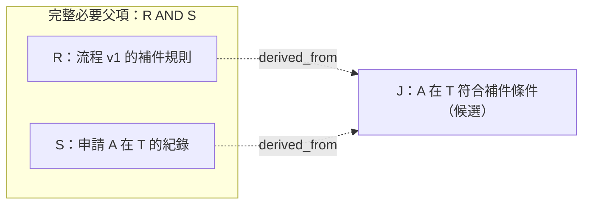
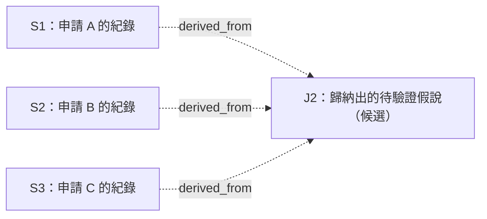

# 用文字案例理解證物、關聯與衍生

**純文字證物可以構成衍生判斷的依據，不需要先有程式碼或 `implements`。**
`derived_from` 記錄推導所需的父項；`implements` 記錄規格與程式碼實作之間經審查的對應。
**歸納出的新判斷可以不存在於任何一份來源原文中。** 它必須透過父項及推導紀錄，
讓人找回實際使用的材料、版本、條件與限制；不能把推論冒充原文。

本文使用合成的申請補件案例，不含實際個案、操作請求或 admission 決策。
本文描述 Product unreleased schema 62／policy v12 契約；範例是教學材料，不代表已提交或批准任何真實證物。

## 先把「證物」拆成材料與命題

| 層次 | 這一層保留什麼 | 在例子裡是什麼 |
| --- | --- | --- |
| 原始材料 | 來源識別、版本、原文、位置與擷取範圍；不是一份模型摘要 | 一份流程規則、一份申請紀錄 |
| 原文依據 | 命題所綁定的 exact source refs／spans；canonical graph 可用 `raw_evidence` 表達原文依據 | 規則中的那一段、申請紀錄中的那一段 |
| 來源命題 `source_claim` | 從材料提出、經審查允入的命題，保留原文依據 | R：規則要求什麼；S：紀錄描述什麼 |
| 衍生命題 `derived_claim` | 經衍生審查允入的判斷，記錄完整必要父項、方法與來源 | J：依 R 與 S，可以作出什麼判斷 |
| 關聯 edge | 特定兩個端點之間、具有特定語意的關係 | 原文支持、推導依賴、引用、矛盾、取代、實作對應 |

`source_claim` 與 `derived_claim` 區分命題的來源方式，不是「文字」與「程式碼」的區分。
規則、政策、觀察都可以是文字命題。原文被保留或命題已允入，也不表示 AHE 證明了來源真實或命題為真。

## 同一組 R、S、J，全部都是文字

合成來源一：流程規則的原文。

> 在申請流程 v1 中，只要申請未提供聯絡方式，就須補件。

合成來源二：申請紀錄的原文。

> 申請 A 適用流程 v1；在本紀錄的觀察時點 T，申請 A 未提供聯絡方式。

假設已經分別完成來源審查，允入兩個來源命題：

| 代號 | 命題 | 來源與限制 |
| --- | --- | --- |
| R | 流程 v1 中，未提供聯絡方式的申請須補件。 | 綁定來源一的規則原文；不擴大到其他流程版本。 |
| S | 申請 A 適用流程 v1，且在觀察時點 T 未提供聯絡方式。 | 綁定來源二的紀錄原文；不推定 A 現在仍缺聯絡方式。 |

現在提出新的判斷候選 J：

> 依保留的流程 v1 規則與申請紀錄，在觀察時點 T，申請 A 符合該規則的須補件條件。

J 的方法是「將 S 所記錄的版本與條件，對照 R 的條件規則」。這不是執行補件通知的授權。
圖中 R、S 是假設已允入的命題；J 與虛線是待審查的衍生目標，尚未建立 canonical 關係。

在 AHE 的儲存方向中，`derived_from` 是 **父項 → 衍生節點**。
J 的完整父項集合是 `{R, S}`，兩者共同構成必要 AND 依賴。找到一條 `R → J` 路徑，
不代表 R 單獨就足夠；S 也不能單獨決定補件規則。若還依賴其他例外條件或身分對應，
就必須保留相應前提，不能讓圖看起來只有 R、S 而漏掉必要依據。

圖呈現的是父項依賴。J 的可追溯性來自 **R、S 及其原文**，加上 **這次推導本身的紀錄**。
J 不必在任何原文中逐字出現，也不必已有一份獨立文件宣告這個結論。
審查要把原文引用與新判斷分別呈現；不能另造一份「原始 J 文件」來滿足介面。

現行 `derived_spec` 仍要求來源綁定的 statement proposal，但命題文字與原文引用是分開保存的，
不能把這個要求解讀為「原文必須已經說出 J」。多來源推導如何完整準備 proposal 與 review，
還需要實際驗收；隨便掛上一筆來源引用，並不代表其他必要依據已完整保留。

允入衍生節點時，節點、完整父項紀錄、`derived_from` edges 與審查 receipt 一起保存。
不能先任意補一條 edge，就把 J 當成已審查的衍生命題。

## 歸納案例：原文沒有規則，能不能提出新判斷？

可以。這次只有三筆合成的處理紀錄，**沒有前一例的規則 R**。
假設它們已形成可追溯的來源命題；S1、S2、S3 是教材代號，不是實際工具 ID。

| 父項 | 各自來源原文記錄的內容 |
| --- | --- |
| S1 | 流程 v1 的申請 A 未提供聯絡方式，處理結果為退回。 |
| S2 | 流程 v1 的申請 B 未提供聯絡方式，處理結果為退回。 |
| S3 | 流程 v1 的申請 C 未提供聯絡方式，處理結果為退回。 |

新提出的歸納候選 J2：

> 這三筆流程 v1 紀錄都同時出現「缺少聯絡方式」與「退回」。
> 據此提出待驗證假說：聯絡方式可能是受理條件之一。

三份原文都沒有寫「聯絡方式是受理條件」，J2 仍然可以被提出並接受衍生審查。
這是在歸納中產生新判斷，不是發現了一段先前漏讀的原文，也不是新增了一筆實際觀察。
圖中虛線仍是待允入目標，沒有表示目前已成功建立歷史 J2。

這次推導至少應保留：

- **依據**：S1、S2、S3 的確切版本與來源片段，以及實際使用的全部父項；三筆紀錄不自動等於三份獨立來源。
- **方法與產生紀錄**：明說這是歸納，記錄如何由這三筆形成假說、由誰／哪個 producer 提出及其可核對的產生紀錄。
- **範圍與不確定性**：目前只有這三筆，尚無提供聯絡方式的對照資料，也未建立代表性或排除其他退回原因；已知反例不得隱藏。
- **判斷與審查**：保留 J2 的限定語、實際提出／審查時間、精確批准內容與理由。

`{S1, S2, S3}` 是這次推導登記的完整 AND 依據集合。這不把歸納變成演繹證明，
也不宣稱每筆樣本在邏輯上不可替代。改用兩筆或加入其他材料，是需要重新審查的推導內容。
完整父項清單只表示已登記的依賴可重建，不能證明全世界的相關資料或反例都已收齊。

審閱者可以認為這個假說太弱而拒絕允入。若允入，仍須保留「待驗證假說」與限制；
不能因為有 `derived_from` 或 admission receipt，就把 J2 改說成所有申請通用的規則或已證實的因果。
Query 應將 S1、S2、S3 的引用呈現為「推導依據的原文」，將 J2 呈現為新產生的歸納判斷；
不能把任何一筆父項的 quote 標成「原文已說出 J2」，也不能只展示一條路徑而隱藏其他必要父項。

## 六種關聯，各自回答不同問題

下表以現行公開契約與支援範圍解說；關係名稱不授權任意端點組合。

| 關聯與儲存方向 | 它回答什麼 | 文字案例或延伸 | 不能從它推出什麼 |
| --- | --- | --- | --- |
| `supports_claim`：原文依據 → 來源命題 | 這個來源命題綁定哪些原文？ | 規則原文 → R；申請紀錄原文 → S。 | 引用可解析不代表命題語意正確，也不證明來源真實。 |
| `derived_from`：父項 → 衍生命題 | 這個判斷依賴哪些已允入的必要命題？ | R、S 共同 → J；或 S1、S2、S3 → 歸納假說 J2。 | 單一父項或一條可達路徑，不等於完整支持；歸納也不因此成為演繹證明。 |
| `references`：引用方 → 被引用方 | 原文中明確的引用指到哪個端點？ | 某段文字有系統支援的原生引用標記，指向規則片段。 | 引用了 R，不代表贊成 R、由 R 推導而來，或實作了 R。 |
| `contradicts`：對稱關係 | 兩個命題在明確範圍與條件下是否存在已審查的衝突？ | 與 S 描述同一申請、同一欄位及同一時點 T 的另一命題，主張聯絡方式已提供。 | 不自動判定哪一方為真，也不把衝突群組補成所有兩兩矛盾。 |
| `supersedes`：新命題 → 舊命題 | 哪個經審查的新版本取代了哪個舊版本？ | 另一個符合外部來源 lineage 契約的案例中，v2 命題取代 v1。 | 較晚時間戳或不同 revision 字串，不會自行建立取代關係。 |
| `implements`：規格 → 程式碼實作端點 | 哪個實作對應這項規格？ | 另一個案例中，衍生規格 D「將缺聯絡方式的申請標為待補件」，對應已允入的 Go 程式碼 C。 | 規格已允入不代表程式已實作；有關係也不等於已執行測試或證明所有行為正確。 |

`derived_from` 本身也是一種關聯，但它是衍生紀錄中的必要依賴。
`references`／`implements` 則各有獨立關係審查；端點審查不會自動批准這些關係。

現行 `references` 還要求合格來源端點、原文中既有的支援標記及可唯一解析的目標，
不能把普通網址或一句「參考 R」直接當成可允入的關係，也不能改寫來源補標記。
現行 `supersedes` 有同一外部物件、lineage、版本及獨立審查等要求；表中的 v2 是概念示意，
不是允許對任意兩個命題連線。各流程以 [System Design](SYSTEM_DESIGN.md#graph) 的契約為準。
`implements` 的 repository-backed Go 端點是現行 writer 的支援範圍；非 Go／非程式碼端點另行討論。

這個純文字 R、S、J 案例沒有程式碼 C，所以不建立 `implements`。
少了 C，不影響「R 與 S 能否支持 J」這個問題；衍生允入仍須通過自己的來源、審查與使用政策門檻。

## 「已收錄」「有關聯」「現在可用」分開看

`admitted` 表示經審查收錄；`currentness=current` 是已記錄版本系譜中的版本現行性；
`eligible` 才是某個 current-use policy 下的使用資格。版本 current 不保證外部世界沒有更新版本，
也不證明內容為真；資料年代久遠本身也不能決定這些狀態。

| 問題 | 要看的材料 | 能得到的結論 |
| --- | --- | --- |
| R、S 是否已收錄？ | 原始來源、允入決策與 receipt。 | 它們是已允入的來源命題。 |
| J 是否已經是衍生命題？ | J 的 endpoint admission、完整 AND 父項、方法與 receipt。 | 經審查允入後，才有 canonical J 與其衍生依賴。 |
| R、S 是否足以支持 J？ | 原文、所有必要前提、版本／時點／範圍、推導方法。 | 由審閱者判斷；圖與合法 ID 不代替語意審查。 |
| J 現在能否當作某個行動的依據？ | 同一明確 current-use policy 下，完整祖先與來源等治理狀態。 | 該狀態切面下的 eligibility；不是行動本身正確或允許執行的證明。 |

例如 A 後來補上聯絡方式，不能繼續把「T 時點缺資料」當成「現在缺資料」。
歷史 J 可保留原來的時間與依據；新的判斷需要相應的新材料與審查。
也不能因為存在 `implements`、`references` 或 SAT 結果，就省略 current-use 與實際行動的檢查。

## 這個案例目前在哪裡會停下來？

為對應 [issue #30](https://github.com/Yui-Qi-Tang/ahe-mcp/issues/30)，再假設 R、S 已允入，
但 currentness 都是 `unclassified_currentness`，例如合格審查後的 `manual_text` 規則 R。
以下區分 current 與獨立歷史用途：

| 流程 | Product 契約 |
| --- | --- |
| 讀取 R、S 已允入紀錄與原文 | 可在有權限且材料可用時查詢；不等於 current。 |
| 原文沒有 J2 這句新判斷 | 可提出歸納假說；保留完整父項、來源、方法與限制。不得捏造 J2 原文。 |
| 建立 current-policy 衍生 J | `derived_spec` admission 在提交交易內檢查完整祖先與自身來源；R、S 的未分類 currentness 會阻擋允入。 |
| 新允入歷史 J／J2 | 獨立 `historical-derivation-reviewer` 先取得完整 review，再以精確人類決策保存衍生命題及 AND 依賴。永久不可 current。 |
| 父項後來循合法途徑成為 current | 歷史 J 及以它為必要祖先的衍生節點仍不可 current；manual_text 沒有因此取得 mark-current 途徑。 |
| 為 R、S → J 建立 implements | 不需要。缺少程式碼不構成這條推導的內容限制。 |

Manual R 須在首次 `submit_text_source` 時原生綁定 `manual_review_profile`，不能事後用 metadata 補資格。
歷史入口是 `get_historical_derivation_review` → 精確人類決策 → `apply_historical_derivation_decision`；
Query `get_evidence_governance_history(kind=historical_derivation)` 以原 occurrence 讀回完整 display／receipt。
完整欄位與界限見[歷史推導契約](HISTORICAL_DERIVATION.md)。

「historical」在 #30 中是永久使用限制的分類，不是把新推導倒填成過去已發生的決策。
來源觀察時點、實際提出／審查時點應各自保留。
永久不可 current 是這個獨立契約的用途分類，不是對所有年代較久的證物作同樣判定。
`historical-derivation-admission/v1` 也不是 current-action 檢查可以接受的替代政策。

## #30 的「嚴格」是脈絡可追溯

以下是獨立歷史入口的允入判準，不會放寬 current 入口：

| 情況 | 歷史推導的處理方向 |
| --- | --- |
| 原文、版本、父項、推導方法與限制可重建，審查內容明確 | 可交由人審查是否收錄；不要求結論已存在於原文。 |
| 原文取不回、引用／版本／hash 對不上、必要依賴缺失或超界、批准與內容不符 | 不新增允入紀錄；不能宣稱來源與脈絡已核對。這不是替人作出終局 reject／audit-only 決策。 |
| 尚未 current、尚未完成額外來源評估、已撤回／被取代或存在矛盾 | 如實顯示狀態及限制，不單因這些狀態就禁止保存歷史分析，也不把收錄當作問題已解除。 |

例如 R1 已被 R2 取代，仍可提出「依 R1 與 S 所作的判斷」，前提是明示使用 R1 及其已被取代狀態。
人仍可因為材料不支持結論而拒絕。歷史收錄不會恢復 R1 的 current-use 資格。
若來源評估指出綁定或原文完整性本身無法核對，就仍屬於可追溯性缺口，不能只加警語便當成已核對。

不把三項額外來源評估全數 pass 當作每次歷史允入的共同前置條件；
已記錄的失敗與不確定性必須保留，不能偽稱已通過。新分類重用現有 PostgreSQL 交易、審查綁定與 exact replay 機制。

## 審查時，系統和人各自釐清什麼？

系統核對來源與版本、exact spans、proposal／端點身分、完整父項、治理狀態與 unchanged review subject，
並依固定契約拒絕不合格輸入。審閱者檢查規則是否適用、時間與範圍是否一致、條件／例外是否完整，
以及是否真的足以支持 J，然後給出精確決策與理由。

按照目前操作契約，在要求 statement／derived／relation 決策前，也須執行相應的 bounded conflict suggestions，
呈現候選、空結果或失敗，以及 coverage／truncation 限制。沒有候選不等於沒有衝突。
這份教學文字本身不是任何原生審查 display，也不批准任何證物或關係。

先讀 [First evidence workflow](FIRST_WORKFLOW.md) 可了解來源命題如何允入；
精確端點條件見 [Exact endpoint admission](SYSTEM_DESIGN.md#exact-endpoint-admission)；
使用限制見 [Current-use guidance](CURRENT_USE_GUIDANCE.md)；
實際審查操作依 [Intake workflow](../.claude/skills/ahe-evidence-intake/SKILL.md)。
